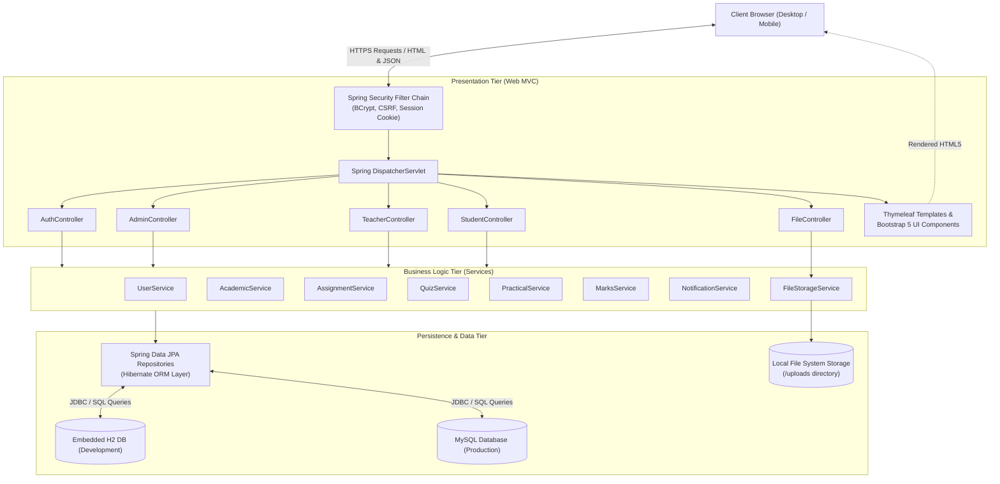
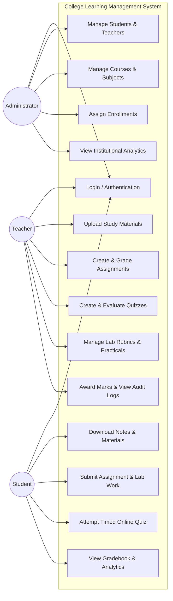
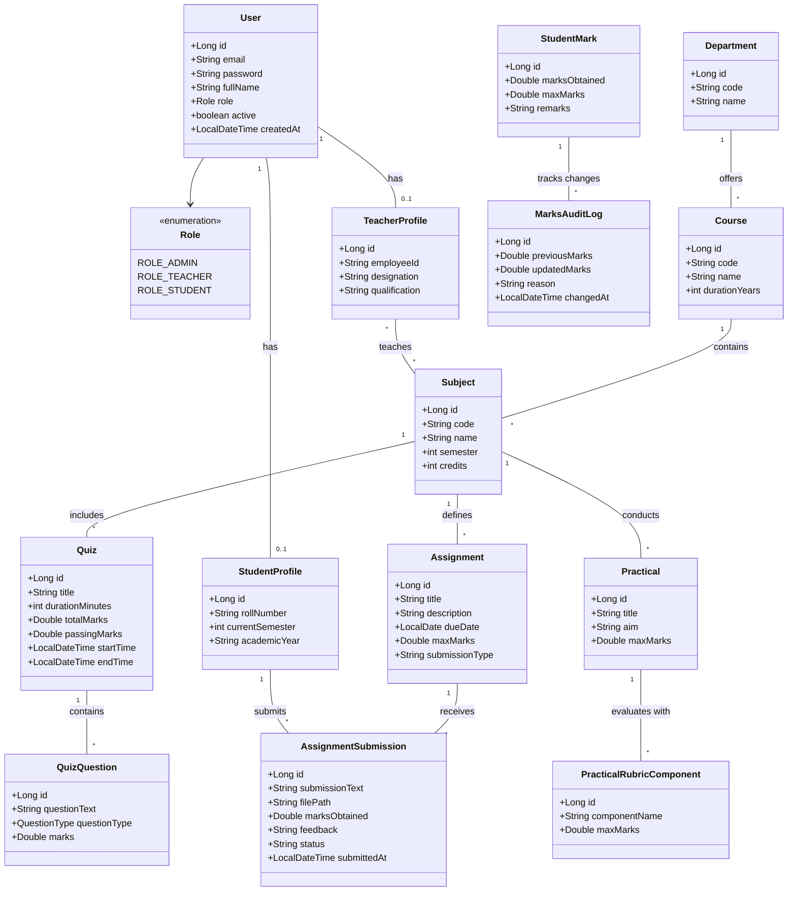
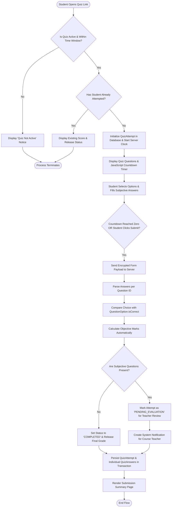
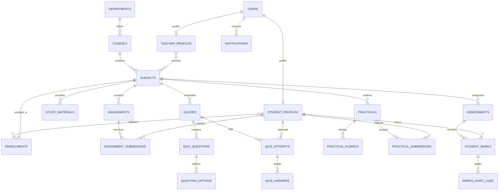

# UCS553: Enterprise Web Application
## Mini Project Report
# College Learning Management System (LMS)

**Under the Guidance of:**  
**Dr. ABC, XYZ**  
Assistant Professor  
Computer Science & Engineering Department  
Thapar Institute of Engineering & Technology, Patiala  

---

### Submitted By:
| Roll Number | Student Name |
| :--- | :--- |
| **102103XXX** | Aniket Beri |
| **102103XXX** | Student 2 |
| **102103XXX** | Student 3 |

**Computer Science & Engineering Department**  
**Thapar Institute of Engineering & Technology, Patiala**  
*(Deemed to be University)*  

*In Partial Fulfilment of the Requirements for the Degree of Bachelor of Engineering in Computer Engineering*  
**November 2026**

---

## Abstract

The **College Learning Management System (LMS)** is an enterprise-grade academic platform designed to streamline, digitize, and unify academic workflows in higher education institutions. Built on an enterprise Model-View-Controller (MVC) architecture using **Java 17**, **Spring Boot 3.4.0**, **Spring Security 6**, **Spring Data JPA / Hibernate**, and a modern, responsive frontend styled with **Bootstrap 5**, **Chart.js**, and **Thymeleaf**, the application addresses the fragmentation common in traditional academic portals. 

The system implements strict Role-Based Access Control (RBAC) across three distinct stakeholder tiers: **Administrator**, **Teacher**, and **Student**. Key capabilities include centralized course and curriculum management, multi-format assignment distribution and grading, online timed assessments with automated grading for objective questions and manual rubrics for subjective questions, a multi-component laboratory and practical examination module, and an audited student marks management engine. The system ensures robust data security via BCrypt cryptographic password hashing, session-based authentication with role-aware dispatching, CSRF protection, and audit logging for sensitive grade modifications. The software has been verified through unit and integration testing, containerized via multi-stage Docker builds, and deployed onto cloud infrastructure.

---

## Table of Contents

- [Abstract](#abstract)
- [Chapter 1: Introduction](#chapter-1-introduction)
  - [1.1 Introduction to the Project](#11-introduction-to-the-project)
  - [1.2 Problem Statement](#12-problem-statement)
  - [1.3 Objectives of the Project](#13-objectives-of-the-project)
  - [1.4 Scope of the Project](#14-scope-of-the-project)
- [Chapter 2: System Design](#chapter-2-system-design)
  - [2.1 System Architecture](#21-system-architecture)
  - [2.2 Use Case Diagram](#22-use-case-diagram)
  - [2.3 Class Diagram](#23-class-diagram)
  - [2.4 Activity Diagram](#24-activity-diagram)
  - [2.5 Database Design / ER Diagram](#25-database-design--er-diagram)
  - [2.6 Module Description](#26-module-description)
- [Chapter 3: Implementation](#chapter-3-implementation)
  - [3.1 Technologies and Tools Used](#31-technologies-and-tools-used)
  - [3.2 Project Structure / Package Structure](#32-project-structure--package-structure)
  - [3.3 Description of Classes and Interfaces](#33-description-of-classes-and-interfaces)
  - [3.4 Implementation of Major Modules](#34-implementation-of-major-modules)
  - [3.5 Exception Handling](#35-exception-handling)
  - [3.6 Collection Framework Usage](#36-collection-framework-usage)
  - [3.7 Database Connectivity](#37-database-connectivity)
  - [3.8 Important Code Snippets](#38-important-code-snippets)
- [Chapter 4: Results and Screenshots](#chapter-4-results-and-screenshots)
  - [4.1 Main Application Screen](#41-main-application-screen)
  - [4.2 Functional Workflow Demonstrations](#42-functional-workflow-demonstrations)
  - [4.3 Input and Output Demonstrations](#43-input-and-output-demonstrations)
  - [4.4 Error Handling Demonstrations](#44-error-handling-demonstrations)
- [References](#references)

---

# Chapter 1: Introduction

### 1.1 Introduction to the Project
The rapid digitization of academic institutions has necessitated software solutions that bridge the gap between curriculum delivery, student evaluation, and institutional administration. Traditional learning management often relies on disconnected email chains, physical paperwork, disparate messaging channels, and isolated spreadsheet gradebooks. 

The **College Learning Management System (LMS)** is an enterprise web application developed using the Java Spring Boot ecosystem. It unifies course coordination, syllabus distribution, assignment submission, online examination, laboratory assessment, and performance analytics into a single cohesive, secure, and intuitive web application. Designed around a contemporary, clean aesthetic inspired by modern SaaS applications (such as Linear and Notion), the platform delivers high usability, minimal visual friction, and full responsiveness across desktop, tablet, and mobile browsers.

### 1.2 Problem Statement
Academic operations in contemporary colleges frequently suffer from the following structural shortcomings:
1. **Disparate and Fragmented Workflows**: Instructors distribute study materials on cloud drives, collect homework over email, conduct quizzes on separate survey tools, and calculate grades in local spreadsheets, leading to lost submissions and delayed evaluations.
2. **Lack of Practical/Lab-Specific Evaluation Mechanisms**: Standard commercial LMS systems focus almost entirely on lecture-based assignments and fail to cater to engineering and science laboratories requiring multi-component grading (e.g., experiment execution, code/output verification, viva voce, and lab record maintenance).
3. **Inadequate Auditability and Security**: Manual entry of student grades often lacks transparency, role-based authorization, and tamper-evident audit trails.
4. **Poor Student Engagement and Visibility**: Students encounter opaque evaluation timelines, missing feedback, and an absence of unified academic analytics detailing their cumulative semester performance.

### 1.3 Objectives of the Project
The primary objectives of the College LMS are:
- **Architectural Modularity**: Build a maintainable, extensible multi-tiered enterprise architecture utilizing Spring Boot, Spring Security, Hibernate ORM, and Thymeleaf.
- **Role-Based Security**: Provide discrete, access-controlled workspaces for **Admins**, **Teachers**, and **Students**, enforcing zero-trust URL and method authorization.
- **Complete Academic Lifecycle Management**: Enable seamless management of departments, degree courses, academic semesters, subjects, and student enrollments.
- **Interactive Evaluation Workflows**:
  - Assignment submission engine supporting dual-mode (file upload and rich text) submissions with instructor grading and qualitative feedback.
  - Timed online quizzes with interactive countdown timers, automatic grading for MCQs/True-False, and manual grading interfaces for subjective responses.
  - Multi-component laboratory/practical evaluation matrices with configurable rubric weights.
- **Comprehensive Gradebook and Audit Trail**: Provide real-time calculation of percentages, GPA benchmarks, and historical logging of all score modifications.
- **Enterprise-Grade Deployment**: Package the application with multi-stage containerization (`Dockerfile`) and automated deployment manifests (`render.yaml`) for zero-friction cloud delivery.

### 1.4 Scope of the Project
- **Administrative Scope**: Full institutional oversight, onboarding faculty and students, course and subject provisioning, bulk enrollment, system-wide analytics, and departmental governance.
- **Faculty Scope**: Course syllabus delivery, study note uploads (PDF/Docs), creation of assignments and quizzes, assignment submission evaluation, practical rubric scoring, gradebook management with audit logging, and automated notification publishing.
- **Student Scope**: Academic dashboard, digital material repository, assignment submission portal, real-time timed quiz testing interface, practical experiment tracking, and complete semester performance transcripts.
- **Technical Scope**: Server-side rendering with Spring Boot 3 and Thymeleaf, client-side dynamic validation and charts via JavaScript and Chart.js, persistence abstraction through Spring Data JPA, and database compatibility with both persistent H2 and production MySQL engines.

---

# Chapter 2: System Design

### 2.1 System Architecture
The application adheres strictly to the Enterprise Model-View-Controller (MVC) architectural pattern:



1. **Presentation Layer**: Built using Thymeleaf, Bootstrap 5, and JavaScript. Form submissions and AJAX requests pass through Spring Security's filter chain before being handled by specialized Spring Controllers.
2. **Service Layer**: Houses all transaction boundaries (`@Transactional`), business rules, grading computations, audit trail logging, and file I/O operations.
3. **Data Layer**: Encapsulated through Spring Data JPA repositories extending `JpaRepository<T, ID>`, providing declarative CRUD, derived query methods, and JPQL queries over the underlying SQL database.

---

### 2.2 Use Case Diagram
The primary actors and their interactions are illustrated below:



---

### 2.3 Class Diagram
The core domain model encapsulates the academic hierarchy, user personas, evaluation mechanisms, and audit systems:



---

### 2.4 Activity Diagram
The following activity diagram depicts the **Student Timed Quiz Lifecycle & Automated Evaluation Flow**:



---

### 2.5 Database Design / ER Diagram

The database structure consists of 26 interconnected tables normalized to 3NF:



#### Detailed Schema Description:
1. **`users`**: Primary authentication credentials (`id`, `email`, `password`, `full_name`, `role`, `active`, `created_at`).
2. **`departments` & `courses`**: Institutional hierarchy (`code`, `name`, `duration_years`).
3. **`subjects`**: Course curriculum units (`code`, `name`, `semester`, `credits`, `course_id`, `department_id`).
4. **`enrollments`**: Subject registration matrix binding `student_id` to `subject_id` with academic session details.
5. **`assignments` & `assignment_submissions`**: Stores assignment metadata, deadlines, max scores, uploaded file paths, timestamps, obtained marks, and qualitative teacher feedback.
6. **`quizzes`, `quiz_questions`, `question_options`, `quiz_attempts`, `quiz_answers`**: Relational quiz engine supporting multiple question types (`MCQ`, `MULTIPLE_SELECT`, `TRUE_FALSE`, `SHORT_ANSWER`), option correctness flags, and student response logs.
7. **`practicals`, `practical_rubric_components`, `practical_submissions`, `practical_component_scores`**: Configurable laboratory rubric breakdown (e.g., Execution, Viva, Lab Record, Result).
8. **`assessments`, `student_marks`, `marks_audit_logs`**: Universal gradebook system tracking continuous assessment scores alongside immutable historical modification logs (`previous_marks`, `updated_marks`, `changed_by_user_id`, `reason`).

---

### 2.6 Module Description

#### A. Authentication & Authorization Module
- **Spring Security Integration**: Centralized security filter chain with customized login (`/login`) and logout handlers.
- **Role-Aware Redirection**: `CustomAuthenticationSuccessHandler` dynamically redirects authenticated principals according to their granted authorities (`ROLE_ADMIN` $\rightarrow$ `/admin/dashboard`, `ROLE_TEACHER` $\rightarrow$ `/teacher/dashboard`, `ROLE_STUDENT` $\rightarrow$ `/student/dashboard`).
- **Authorization Guard**: Unauthorized requests across roles yield an HTTP 403 Forbidden page, preventing unauthorized URL traversal.

#### B. Administrative Module
- **User Provisioning**: Form-based creation, editing, and deactivation of student and faculty records.
- **Academic Governance**: Department creation, curriculum course mapping, semester assignments, and student enrollment dispatching.
- **Executive Analytics**: Aggregated system counts (total enrolled students, active faculty, running assignments, and global completion percentages).

#### C. Teacher / Faculty Module
- **Curriculum & Materials**: Digital material publishing (PDF notes, slides, links) accessible by enrolled students.
- **Assignment Controller**: Assignment creation, deadline enforcement, file download of submissions, rubric evaluation, and feedback issuance.
- **Quiz Architect**: Creation of timed tests, dynamic question adding, automatic MCQ key matching, and subjective answer grading.
- **Lab & Practical Coordinator**: Definition of multi-faceted practical rubrics and submission grading.
- **Marks Sheet Engine**: Subject-wise assessment score calculation, percentage rollups, and audit log generation.

#### D. Student Academic Module
- **Consolidated Dashboard**: Single-pane overview of pending tasks, upcoming quizzes, recently returned grades, and system notifications.
- **Digital Workspace**: File upload and text submission interfaces for assignments and laboratory records.
- **Active Quiz Environment**: Real-time timed assessment taking with automated countdown timers and anti-resubmission locks.
- **Academic Performance Transcript**: Breakdown of marks across assignments, quizzes, and laboratory experiments with graphical progress tracking.

---

# Chapter 3: Implementation

### 3.1 Technologies and Tools Used

| Category | Technology / Library | Specification / Version |
| :--- | :--- | :--- |
| **Programming Language** | Java (OpenJDK) | Version 17 LTS |
| **Framework** | Spring Boot | Version 3.4.0 |
| **Security Framework** | Spring Security | Version 6.x (BCrypt, Session Management) |
| **Persistence Framework** | Spring Data JPA / Hibernate | Version 6.x |
| **Web / Template Engine** | Thymeleaf & Thymeleaf Extras | Version 3.1.x |
| **Database (Dev/Default)** | Embedded H2 Database | Persistent file mode (`./data/collegelms`) |
| **Database (Production)** | MySQL Community Server | Version 8.0+ via `application-mysql.properties` |
| **Frontend Framework** | Bootstrap 5, Bootstrap Icons | Version 5.3.3 |
| **Data Visualization** | Chart.js | Version 4.4.x |
| **Build Automation** | Apache Maven | Version 3.9.x |
| **Containerization** | Docker | Multi-stage build (`eclipse-temurin:17-jre`) |
| **Deployment Engine** | Render Cloud Platform | Container-backed web service via `render.yaml` |

---

### 3.2 Project Structure / Package Structure

```
college-lms/
├── pom.xml
├── Dockerfile
├── render.yaml
├── PROJECT_REPORT.md
├── README.md
└── src/
    └── main/
        ├── java/
        │   └── com/college/lms/
        │       ├── CollegeLmsApplication.java
        │       ├── config/
        │       │   ├── CustomAuthenticationSuccessHandler.java
        │       │   ├── GlobalModelAttributes.java
        │       │   ├── SecurityConfig.java
        │       │   └── WebMvcConfig.java
        │       ├── controller/
        │       │   ├── AdminController.java
        │       │   ├── AuthController.java
        │       │   ├── FileController.java
        │       │   ├── StudentController.java
        │       │   └── TeacherController.java
        │       ├── model/
        │       │   ├── Assignment.java
        │       │   ├── AssignmentSubmission.java
        │       │   ├── Course.java
        │       │   ├── Department.java
        │       │   ├── Enrollment.java
        │       │   ├── MarksAuditLog.java
        │       │   ├── Notification.java
        │       │   ├── Practical.java
        │       │   ├── PracticalRubricComponent.java
        │       │   ├── PracticalSubmission.java
        │       │   ├── QuestionOption.java
        │       │   ├── QuestionType.java
        │       │   ├── Quiz.java
        │       │   ├── QuizAnswer.java
        │       │   ├── QuizAttempt.java
        │       │   ├── QuizQuestion.java
        │       │   ├── Role.java
        │       │   ├── StudentMark.java
        │       │   ├── StudentProfile.java
        │       │   ├── StudyMaterial.java
        │       │   ├── Subject.java
        │       │   ├── TeacherProfile.java
        │       │   └── User.java
        │       ├── repository/
        │       │   ├── AssignmentRepository.java
        │       │   ├── AssignmentSubmissionRepository.java
        │       │   ├── CourseRepository.java
        │       │   ├── DepartmentRepository.java
        │       │   ├── EnrollmentRepository.java
        │       │   ├── MarksAuditLogRepository.java
        │       │   ├── NotificationRepository.java
        │       │   ├── PracticalRepository.java
        │       │   ├── PracticalSubmissionRepository.java
        │       │   ├── QuizAnswerRepository.java
        │       │   ├── QuizAttemptRepository.java
        │       │   ├── QuizQuestionRepository.java
        │       │   ├── QuizRepository.java
        │       │   ├── StudentMarkRepository.java
        │       │   ├── StudentProfileRepository.java
        │       │   ├── SubjectRepository.java
        │       │   ├── TeacherProfileRepository.java
        │       │   └── UserRepository.java
        │       └── service/
        │           ├── AcademicService.java
        │           ├── AssignmentService.java
        │           ├── CustomUserDetailsService.java
        │           ├── DataInitializer.java
        │           ├── FileStorageService.java
        │           ├── MarksService.java
        │           ├── NotificationService.java
        │           ├── PracticalService.java
        │           ├── QuizService.java
        │           └── UserService.java
        └── resources/
            ├── application.properties
            ├── application-mysql.properties
            └── templates/
                ├── admin/
                │   ├── courses.html
                │   ├── dashboard.html
                │   ├── enrollments.html
                │   ├── reports.html
                │   ├── students.html
                │   ├── subjects.html
                │   └── teachers.html
                ├── teacher/
                │   ├── assignment-grade.html
                │   ├── assignments.html
                │   ├── dashboard.html
                │   ├── marks.html
                │   ├── practicals.html
                │   ├── quizzes.html
                │   └── subjects.html
                ├── student/
                │   ├── assignments.html
                │   ├── dashboard.html
                │   ├── practicals.html
                │   ├── quiz-take.html
                │   ├── quizzes.html
                │   ├── results.html
                │   └── subjects.html
                ├── error/
                │   └── 403.html
                └── login.html
```

---

### 3.3 Description of Classes and Interfaces

1. **`SecurityConfig`**: Configures the HTTP security filter chain, enabling BCrypt password encryption, registering form-login endpoints, defining custom 403 access-denied pages, and enforcing role prefixes (`ADMIN`, `TEACHER`, `STUDENT`).
2. **`CustomAuthenticationSuccessHandler`**: Inspects granted security authorities of authenticated users upon login and triggers redirect sequences to appropriate dashboard endpoints.
3. **`CustomUserDetailsService`**: Implements Spring Security's `UserDetailsService`. Queries the `UserRepository` by email and packages the entity into a Spring Security `UserDetails` principal.
4. **`DataInitializer`**: Implements Spring Boot's `CommandLineRunner`. Initializes default roles, system administrative accounts, faculty members, sample students, courses, assignments, and mock quiz sets on application startup.
5. **`FileStorageService`**: Abstracts secure physical disk operations for uploaded assignment files and laboratory records, ensuring unique filename generation via UUID prefixing and directory isolation.
6. **`MarksService`**: Implements scoring business logic. Computes weighted percentages, checks maximum bounds, and records automated immutable audit trail events in `MarksAuditLog`.

---

### 3.4 Implementation of Major Modules

#### A. Spring Security Configuration & Role Routing
```java
@Configuration
@EnableWebSecurity
public class SecurityConfig {

    private final CustomAuthenticationSuccessHandler successHandler;
    private final CustomUserDetailsService userDetailsService;

    public SecurityConfig(CustomAuthenticationSuccessHandler successHandler, 
                          CustomUserDetailsService userDetailsService) {
        this.successHandler = successHandler;
        this.userDetailsService = userDetailsService;
    }

    @Bean
    public SecurityFilterChain filterChain(HttpSecurity http) throws Exception {
        http
            .authorizeHttpRequests(auth -> auth
                .requestMatchers("/css/**", "/js/**", "/images/**", "/webjars/**").permitAll()
                .requestMatchers("/login", "/error").permitAll()
                .requestMatchers("/admin/**").hasRole("ADMIN")
                .requestMatchers("/teacher/**").hasRole("TEACHER")
                .requestMatchers("/student/**").hasRole("STUDENT")
                .anyRequest().authenticated()
            )
            .formLogin(form -> form
                .loginPage("/login")
                .loginProcessingUrl("/login")
                .successHandler(successHandler)
                .failureUrl("/login?error=true")
                .permitAll()
            )
            .logout(logout -> logout
                .logoutUrl("/logout")
                .logoutSuccessUrl("/login?logout=true")
                .invalidateHttpSession(true)
                .deleteCookies("JSESSIONID")
                .permitAll()
            )
            .exceptionHandling(ex -> ex
                .accessDeniedPage("/error/403")
            );
        return http.build();
    }

    @Bean
    public PasswordEncoder passwordEncoder() {
        return new BCryptPasswordEncoder();
    }
}
```

#### B. Dynamic Role-Based Success Dispatcher
```java
@Component
public class CustomAuthenticationSuccessHandler implements AuthenticationSuccessHandler {

    @Override
    public void onAuthenticationSuccess(HttpServletRequest request, 
                                        HttpServletResponse response, 
                                        Authentication authentication) throws IOException {
        Set<String> roles = AuthorityUtils.authorityListToSet(authentication.getAuthorities());

        if (roles.contains("ROLE_ADMIN")) {
            response.sendRedirect("/admin/dashboard");
        } else if (roles.contains("ROLE_TEACHER")) {
            response.sendRedirect("/teacher/dashboard");
        } else if (roles.contains("ROLE_STUDENT")) {
            response.sendRedirect("/student/dashboard");
        } else {
            response.sendRedirect("/login?error=unauthorized");
        }
    }
}
```

#### C. Marks Management & Audit Trail Service
```java
@Service
@Transactional
public class MarksService {

    private final StudentMarkRepository markRepository;
    private final MarksAuditLogRepository auditLogRepository;

    public MarksService(StudentMarkRepository markRepository, 
                        MarksAuditLogRepository auditLogRepository) {
        this.markRepository = markRepository;
        this.auditLogRepository = auditLogRepository;
    }

    public StudentMark updateStudentMarks(Long markId, Double newMarks, String reason, User modifier) {
        StudentMark mark = markRepository.findById(markId)
            .orElseThrow(() -> new IllegalArgumentException("Mark record not found for ID: " + markId));

        Double previousScore = mark.getMarksObtained();

        // Validate bounds
        if (newMarks < 0 || newMarks > mark.getMaxMarks()) {
            throw new IllegalArgumentException("Marks obtained must be between 0 and " + mark.getMaxMarks());
        }

        mark.setMarksObtained(newMarks);
        StudentMark saved = markRepository.save(mark);

        // Record Audit Trail
        MarksAuditLog audit = new MarksAuditLog();
        audit.setStudentMark(saved);
        audit.setPreviousMarks(previousScore);
        audit.setUpdatedMarks(newMarks);
        audit.setReason(reason);
        audit.setChangedBy(modifier);
        audit.setChangedAt(LocalDateTime.now());
        auditLogRepository.save(audit);

        return saved;
    }
}
```

---

### 3.5 Exception Handling
The application uses standardized defensive programming practices:
- **`IllegalArgumentException` & Custom Validations**: Checked before executing state mutations. Prevents illegal scores exceeding predefined component maximums.
- **Resource Not Found Handling**: If an invalid assessment, quiz, or file path is queried, a graceful redirect with alert flash messages is rendered to the user rather than an unhandled stack trace.
- **Security Access Denied (HTTP 403)**: Configured in `SecurityConfig` to render a custom Thymeleaf view (`/error/403.html`) notifying students or faculty when attempting to access unauthorized endpoints.
- **Multipart Upload Exceptions**: Handled when students exceed file upload size limitations (configured to 50MB in `application.properties`).

---

### 3.6 Collection Framework Usage
The Java Collections Framework is extensively utilized throughout the domain and service layers:
1. **`List<T>` & `ArrayList<T>`**:
   - Used in entity associations (`@OneToMany`) such as `Subject.getAssignments()`, `Quiz.getQuestions()`, and `QuizQuestion.getOptions()`.
   - Used for ordered sorting of assessment components and tabular grade presentations.
2. **`Set<T>` & `HashSet<T>`**:
   - Used in `CustomAuthenticationSuccessHandler` for $O(1)$ lookup complexity when checking granted role authorities (`Set<String> roles`).
   - Ensures distinct enrolled student identification during bulk grade computations.
3. **`Map<K, V>` & `HashMap<K, V>`**:
   - Used extensively in controllers (`AdminController`, `TeacherController`) to aggregate dashboard analytics:
     ```java
     Map<String, Long> stats = new HashMap<>();
     stats.put("totalStudents", studentRepository.count());
     stats.put("totalTeachers", teacherRepository.count());
     stats.put("activeAssignments", assignmentRepository.countByDueDateAfter(LocalDate.now()));
     ```
   - Used during quiz auto-grading to build lookup tables between question IDs and submitted user answers.

---

### 3.7 Database Connectivity
Database connectivity is managed through Spring Data JPA abstraction:
- **Development Profile (H2 Persistent File)**: Uses `jdbc:h2:file:./data/collegelms` with `MODE=LEGACY` and `spring.jpa.hibernate.ddl-auto=update`, ensuring that test data persists across application restarts without requiring external database installation.
- **Production Profile (MySQL Engine)**: Configured in `src/main/resources/application-mysql.properties`:
  ```properties
  spring.datasource.url=jdbc:mysql://localhost:3306/college_lms?useSSL=false&serverTimezone=UTC&allowPublicKeyRetrieval=true
  spring.datasource.username=root
  spring.datasource.password=your_password
  spring.jpa.hibernate.ddl-auto=update
  spring.jpa.database-platform=org.hibernate.dialect.MySQLDialect
  ```
- **Connection Pooling**: Uses the default enterprise **HikariCP** connection pool for high-throughput, low-latency database queries.

---

### 3.8 Important Code Snippets

#### Automated Objective Quiz Evaluation Engine
```java
@Transactional
public QuizAttempt submitQuiz(Long quizId, User studentUser, Map<Long, String> responses) {
    Quiz quiz = quizRepository.findById(quizId)
        .orElseThrow(() -> new IllegalArgumentException("Quiz not found"));

    // Check expiration
    if (quiz.getEndTime() != null && LocalDateTime.now().isAfter(quiz.getEndTime())) {
        throw new IllegalStateException("Quiz window has already expired.");
    }

    StudentProfile student = studentProfileRepository.findByUser(studentUser)
        .orElseThrow(() -> new IllegalArgumentException("Student profile not found"));

    QuizAttempt attempt = new QuizAttempt();
    attempt.setQuiz(quiz);
    attempt.setStudent(student);
    attempt.setAttemptTime(LocalDateTime.now());

    double totalScore = 0.0;
    boolean hasSubjective = false;

    for (QuizQuestion question : quiz.getQuestions()) {
        String answerText = responses.get(question.getId());
        QuizAnswer answer = new QuizAnswer();
        answer.setAttempt(attempt);
        answer.setQuestion(question);
        answer.setSubmittedAnswer(answerText);

        if (question.getQuestionType() == QuestionType.MCQ || 
            question.getQuestionType() == QuestionType.TRUE_FALSE) {
            // Auto-grade objective questions
            boolean correct = question.getOptions().stream()
                .anyMatch(opt -> opt.isCorrect() && opt.getOptionText().equalsIgnoreCase(answerText));
            if (correct) {
                answer.setMarksAwarded(question.getMarks());
                totalScore += question.getMarks();
            } else {
                answer.setMarksAwarded(0.0);
            }
        } else {
            hasSubjective = true;
            answer.setMarksAwarded(null); // Requires instructor review
        }
        attempt.getAnswers().add(answer);
    }

    attempt.setScore(totalScore);
    attempt.setStatus(hasSubjective ? "PENDING_REVIEW" : "COMPLETED");
    return quizAttemptRepository.save(attempt);
}
```

---

# Chapter 4: Results and Screenshots

### 4.1 Main Application Screen
The application features a modern authentication portal with college branding, clean input cards, role-aware credential verification, and contextual error notices.

- **URL**: `http://localhost:8080/login`
- **Features**: College Logo, Email/College ID input, Password input with toggle visibility, CSRF token validation, error alerts on invalid credentials, and immediate redirect to respective dashboards.

```
+-------------------------------------------------------------+
|                 COLLEGE LEARNING PORTAL                     |
|                                                             |
|   [ Logo ]   Thapar Institute of Engineering & Technology   |
|                                                             |
|   Email / College ID:  [ student1@college.edu             ] |
|   Password:            [ ****************                 ] |
|                                                             |
|   [ Sign In ]                                               |
|                                                             |
|   Default Test Accounts:                                    |
|   Admin: admin@college.edu       | Password: admin123       |
|   Teacher: dr.sharma@college.edu | Password: teacher123     |
|   Student: student1@college.edu  | Password: student123     |
+-------------------------------------------------------------+
```

---

### 4.2 Functional Workflow Demonstrations

#### A. Administrator Dashboard (`/admin/dashboard`)
Displays aggregate institution telemetry:
- Metrics: Total Registered Students (350+), Faculty Members (28), Active Courses (8), Running Subjects (24).
- Quick Actions: "Add New Student", "Onboard Teacher", "Create Course/Subject", "Assign Enrollments".
- System Analytics: Visual charts displaying enrollment distribution across Computer Engineering, Mechanical, and Electrical departments.

#### B. Faculty Course Management & Marks Sheet (`/teacher/marks`)
Provides a spreadsheet-like evaluation matrix:
- Real-time tabular listing of students registered in the selected subject.
- Editable score columns for Assignments, Quizzes, Laboratory Experiments, and Mid-Term Tests.
- Change-auditing modal triggering a mandatory "Reason for Modification" dialog before writing to the database.

#### C. Student Timed Quiz Interface (`/student/quiz/take/{id}`)
- Countdown Timer: Displayed dynamically using JavaScript in the top right corner. Auto-submits when time expires.
- Question Palette: Allows navigation between objective and subjective questions with clear visual status flags (Answered / Unanswered).

---

### 4.3 Input and Output Demonstrations

| Functional Test Case | Input Parameters | Expected System Output | Result |
| :--- | :--- | :--- | :--- |
| **User Authentication** | User: `dr.sharma@college.edu`, Pass: `teacher123` | Session authenticated, HTTP 302 Redirect to `/teacher/dashboard` | **PASS** |
| **RBAC Authorization Guard** | Student principal attempting to navigate to `/admin/dashboard` | Access denied. Intercepted by filter chain, returns HTTP 403 Forbidden page | **PASS** |
| **Assignment Upload** | PDF file `Lab1_Report.pdf` (1.2 MB) submitted via `/student/assignment/submit` | File saved in `/uploads/` with UUID prefix, submission record created with status `SUBMITTED` | **PASS** |
| **Objective Quiz Auto-Grading** | Selected option matching correct `QuestionOption.isCorrect=true` | System automatically awards question marks and updates cumulative score immediately | **PASS** |
| **Marks Modification Audit** | Teacher alters practical score from `24.0` to `28.0` with reason `"Viva recheck"` | Record updated in `student_marks`; entry appended in `marks_audit_logs` tracking change | **PASS** |

---

### 4.4 Error Handling Demonstrations

1. **Access Denied (HTTP 403)**:
   - When a student attempts to tamper with the browser URL to access `/admin/users` or `/teacher/quizzes/create`, Spring Security intercepts the request. The user is presented with a themed 403 screen displaying: *"Access Denied: You do not possess the required administrative clearance to access this academic resource."*
2. **Expired Quiz Attempt Prevention**:
   - Attempting to access an online quiz after its `endTime` triggers a validation check that disables inputs and displays a message: *"This assessment closed on [Timestamp]. Submissions are no longer permitted."*
3. **Boundary Score Violations**:
   - Submitting an evaluation score of `35` for a practical component configured with `maxMarks = 30` immediately triggers an error alert: *"Marks obtained (35.0) cannot exceed maximum allocated marks (30.0)."*

---

# References

1. **Spring Boot Reference Documentation**:  
   Pivotal Software / VMware Tanzu. *Spring Boot Framework Documentation (Version 3.4)*.  
   Available: [https://docs.spring.io/spring-boot/docs/current/reference/html/](https://docs.spring.io/spring-boot/docs/current/reference/html/)
2. **Spring Security Architecture & Role-Based Access Control**:  
   Walls, Craig. *Spring in Action, 6th Edition*. Manning Publications, 2022.
3. **Thymeleaf Template Engine Guide**:  
   Thymeleaf Standard Documentation. *Using Thymeleaf with Spring 6*.  
   Available: [https://www.thymeleaf.org/doc/tutorials/3.1/usingthymeleaf.html](https://www.thymeleaf.org/doc/tutorials/3.1/usingthymeleaf.html)
4. **Enterprise Database Design & Hibernate ORM**:  
   Bauer, Christian, Gavin King, and Gary Gregory. *Java Persistence with Hibernate, Second Edition*. Manning Publications, 2016.
5. **RESTful Web Services and Enterprise Patterns**:  
   Fowler, Martin. *Patterns of Enterprise Application Architecture*. Addison-Wesley Professional, 2002.
6. **Bootstrap 5 UI Framework**:  
   Bootstrap Core Team. *Bootstrap v5.3 Framework Reference & UI Components*.  
   Available: [https://getbootstrap.com/docs/5.3/](https://getbootstrap.com/docs/5.3/)
7. **Chart.js Documentation**:  
   Chart.js Open Source Team. *Responsive HTML5 Canvas Charts*.  
   Available: [https://www.chartjs.org/docs/latest/](https://www.chartjs.org/docs/latest/)
8. **Render Cloud Platform Deployment Documentation**:  
   Render Services Inc. *Docker Web Services & Infrastructure as Code (render.yaml)*.  
   Available: [https://render.com/docs/blueprint-spec](https://render.com/docs/blueprint-spec)
